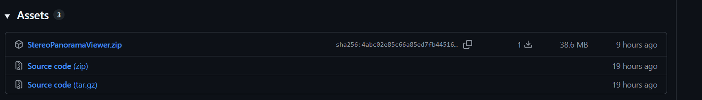

<div align="center">

# 🥽 Stereo Panorama Viewer


### Trình xem Stereo Panorama Photosphere / Moviesphere với **thị sai độ sâu (Depth Parallax)**


**Bài tập lớn cuối kỳ · Môn _Xây dựng ứng dụng thực tế ảo_ · Đề tài 29**

</div>

---

## 📚 Thông tin học phần

| Mục                         | Nội dung                     |
| --------------------------- | ---------------------------- |
| 📖 **Môn học**              | Xây dựng ứng dụng thực tế ảo |
| 👨‍🏫 **Giảng viên hướng dẫn** | ThS. Đỗ Trí Nhựt             |
| 👨‍🎓 **Sinh viên thực hiện**  | Nguyễn Tuấn Anh              |
| 🪪 **MSSV**                 | 23050118                     |

---

## 🌌 Giới thiệu

Ảnh panorama 360° thông thường chỉ cho phép xoay đầu (**3 bậc tự do – 3DoF**). Khi người xem dịch chuyển đầu, cảnh không thay đổi nên thiếu cảm giác chiều sâu thật.

Dự án xây dựng một trình xem panorama 360° có:

|     | Tính năng                            | Mô tả                                                                                                                                     |
| --- | ------------------------------------ | ----------------------------------------------------------------------------------------------------------------------------------------- |
| 👀  | **Stereo**                           | Hiển thị cặp ảnh trái/phải lên hai mắt để tạo cảm giác 3D.                                                                                |
| 🌊  | **Thị sai độ sâu (Motion Parallax)** | Dùng bản đồ độ sâu (depth map) để dịch chuyển các đỉnh (vertex) của mặt cầu, giúp vật gần dịch chuyển nhiều hơn vật xa khi đầu tịnh tiến. |

> 📘 Cơ sở lý thuyết tham khảo từ giáo trình _Virtual Reality_ của **Steven M. LaValle** (các chương về thị giác, quang học và tạo cảm giác chiều sâu).

---

## 🛠️ Công nghệ sử dụng

| Công nghệ                                    | Vai trò                                                     |
| -------------------------------------------- | ----------------------------------------------------------- |
| 🎮 **Unity 6 LTS** (`6000.3.25f1`) + **URP** | Nền tảng và pipeline render (Universal Render Pipeline)     |
| 🧩 **Shader Graph**                          | Shader displacement theo depth map                          |
| 💻 **C#** (Visual Studio) + **Input System** | Mô hình hóa mặt cầu, điều khiển đầu (chuột/phím), giao diện |
| 🎨 **Blender** (Cycles)                      | Tạo ảnh panorama màu (trái/phải) và depth map đầu vào       |
| 🔀 **Git / GitHub**                          | Quản lý phiên bản                                           |

---

## 🚀 Hướng dẫn chạy

### Cách 1: Chạy bản build (không cần cài Unity)

1. Vào mục **Releases** của repo, tải file `.zip` mới nhất: - [`Xem StereoPanoramaViewer v1.0.0`](https://github.com/NguyenTAnh2005/StereoPanoramaViewer/releases/tag/StereoPanoramaViewer_v1.0.0) ↗️ _(Giữ Ctrl để mở trong tab mới)_

   

2. Giải nén **toàn bộ** (giữ nguyên thư mục dữ liệu đi kèm file `.exe`).
3. Chạy file `StereoPanoramaViewer.exe`. Yêu cầu: Windows 64-bit, nên có card đồ họa rời để đạt 90+ FPS.

### Cách 2: Mở project trong Unity

1. Cài **Unity 6000.3.25f1** (kèm module Windows Build Support).
2. Clone repo, mở thư mục project bằng Unity Hub.
3. Mở scene trong `Assets/Scenes/` rồi nhấn Play.

### 🎮 Điều khiển

| Thao tác                      | Chức năng                                              |
| ----------------------------- | ------------------------------------------------------ |
| Giữ **chuột phải** + rê chuột | Xoay đầu (yaw / pitch)                                 |
| **W A S D**                   | Dịch đầu trên mặt phẳng ngang (tối đa 0.3 m quanh gốc) |
| Các nút `64×32` … `4096×2048` | Đổi mức chia lưới mặt cầu                              |
| **Displacement: ON/OFF**      | Bật/tắt thị sai theo depth map                         |
| **Reset vị trí**              | Đưa đầu về vị trí gốc                                  |

---

## 📁 Cấu trúc thư mục

```bash
StereoPanoramaViewer/
├── 📂 Assets/
│   ├── 📜 Scripts/        # Mã nguồn C#
│   │   ├── SphereMeshGenerator.cs   # Sinh lưới cầu, UV equirectangular, lật mặt vào trong
│   │   ├── HeadController.cs        # Xoay đầu bằng chuột (yaw/pitch)
│   │   ├── HeadMover.cs             # Dịch đầu bằng WASD, giới hạn quanh gốc
│   │   ├── DisplacementControl.cs   # Bật/tắt displacement của shader
│   │   ├── SettingsPanel.cs         # Giao diện cài đặt (OnGUI)
│   │   └── FPSCounter.cs            # Hiển thị FPS / ms mỗi frame
│   ├── ✨ Shaders/        # Shader Graph (displacement theo depth map)
│   ├── 🎨 Materials/      # Material dùng shader trên
│   ├── 🖼️ Textures/       # Ảnh panorama màu (trái/phải) và depth map
│   └── 🎬 Scenes/         # Scene chính
├── 🎨 BlenderSource/      # File .blend và script build_models.py dựng cảnh test
├── 📂 Docs/               # Kế hoạch chi tiết ban đầu
├── 📝 Report/             # Báo cáo (Word) và slide (pptx)
├── 📦 Builds/             # Bản build (không đưa lên Git, phát hành qua Releases)
├── 🚫 .gitignore          # Bỏ qua Library, Temp, Logs, Builds, ... do Unity tự sinh
└── 📝 README.md
```

---

## 🗺️ Tiến độ

📄 [**File kế hoạch chi tiết**](./Docs/chi-tiet-ke-hoach.md) _(kế hoạch ban đầu; tên script và một số thông số thực tế có thể khác, xem mục cấu trúc thư mục ở trên)_

| Chặng | Nội dung                                                        |  Trạng thái   |
| :---: | --------------------------------------------------------------- | :-----------: |
| **0** | Thiết lập môi trường (Unity URP, Visual Studio, Git/GitHub)     | ✅ Hoàn thành |
| **1** | Dữ liệu đầu vào từ Blender (panorama, cặp trái/phải, depth map) | ✅ Hoàn thành |
| **2** | Trình xem 360° cơ bản (mặt cầu, điều khiển nhìn quanh)          | ✅ Hoàn thành |
| **3** | Stereo (hai camera, chia viewport)                              | ✅ Hoàn thành |
| **4** | Shader displacement theo độ sâu (Shader Graph)                  | ✅ Hoàn thành |
| **5** | Tịnh tiến đầu, giao diện cài đặt, đo FPS                        | ✅ Hoàn thành |
| **6** | Báo cáo                                                         | ✅ Hoàn thành |

---

## 🎯 Tiêu chí đánh giá (tham khảo)

|  Tỷ trọng  | Tiêu chí                                               |
| :--------: | ------------------------------------------------------ |
| 🟦 **40%** | Độ chính xác kỹ thuật / cảm thụ                        |
| 🟩 **40%** | Kiến trúc phần mềm và hiệu năng (mục tiêu **90+ FPS**) |
| 🟨 **20%** | Báo cáo kỹ thuật                                       |

---

<div align="center">

⭐ _Nếu thấy dự án thú vị, hãy để lại một ngôi sao nhé!_ ⭐

**Made with ❤️ và Unity bởi Nguyễn Tuấn Anh · 23050118**

**File markdown được viết bởi Claude**

</div>
